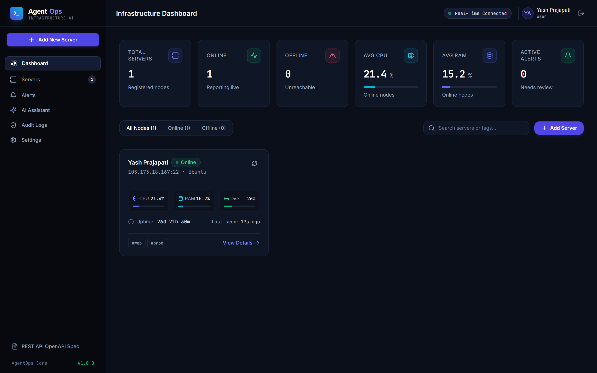
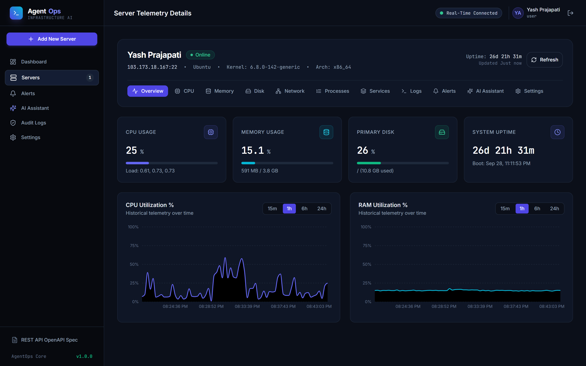
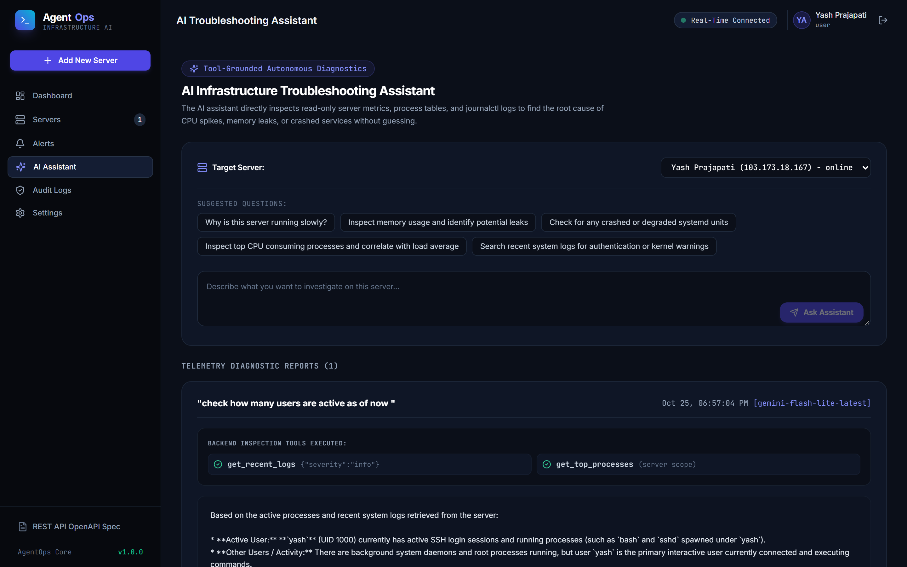
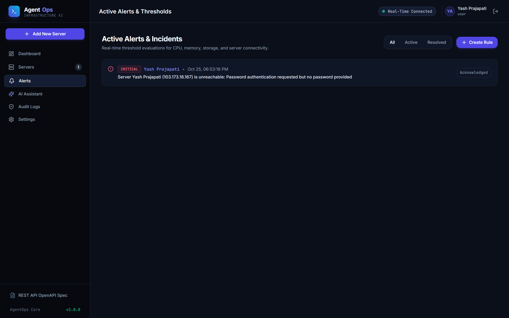
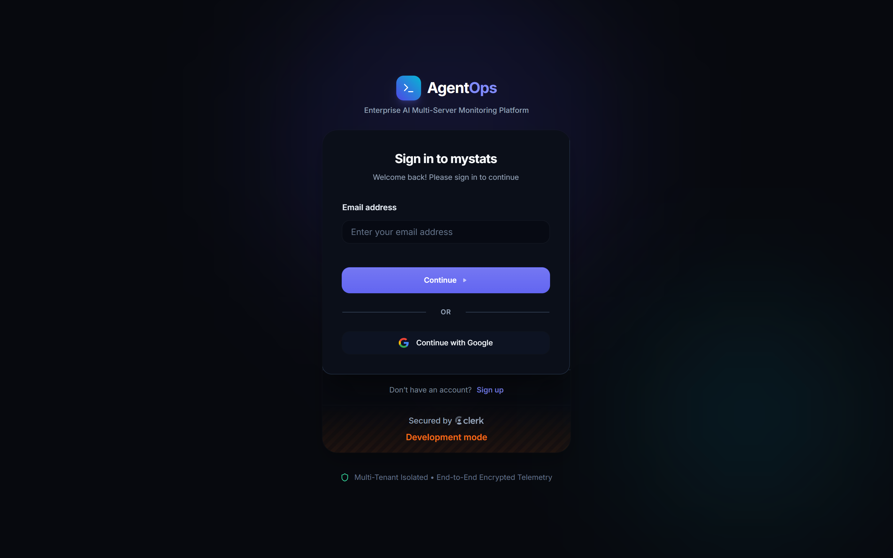

# AgentOps: AI-Powered Multi-Server Monitoring and Troubleshooting Platform

AgentOps is an end-to-end, multi-tenant SaaS application for monitoring and troubleshooting remote Linux servers (Ubuntu & Debian) through a modern web interface.

Built with a production architecture, AgentOps combines real-time Linux telemetry collection with an autonomous AI troubleshooting assistant grounded in verifiable system evidence.

---

## 📸 Platform Screenshots

### 1. Infrastructure Dashboard
*Real-time server fleet monitoring, instant health status badges, and live telemetry cards.*


### 2. Deep-Dive Server Telemetry & Performance Charts
*Interactive time-series performance graphs (CPU, RAM, Disk, Network) with top process tables, systemd services, and live journalctl log inspection.*


### 3. AI Troubleshooting Assistant
*Autonomous LLM troubleshooting agent using 10 strictly read-only diagnostic tools to inspect processes, logs, and system metrics without hallucination.*


### 4. Alert Rules & Incident Management
*Dynamic threshold rules with automatic resolution, cooldown hysteresis, and real-time WebSocket alerts.*


### 5. Landing & Authentication
| Modern Dark Landing Page | High-Contrast Clerk Authentication |
| :---: | :---: |
|  |  |

---

## Key Features

- **Multi-Tenant Server Fleet Management**: Connect, monitor, and organize multiple remote VPS nodes from a single interface.
- **Accurate Linux Telemetry**:
  - **CPU**: True active-to-total cycle utilization calculated from `/proc/stat` differential, 1/5/15m load averages, core counts, and per-core usage.
  - **Memory**: Accurate used memory based on `MemAvailable` from `/proc/meminfo`, handling reclaimable buffers, cache, and swap.
  - **Storage**: Real-time partition capacity, mount points, and inode utilization from `df -PB1`.
  - **Networking**: Dynamic throughput rates (Rx/Tx bytes per second), errors, and dropped packets from `/proc/net/dev`.
  - **Systemd & Processes**: Paginated top process table sorted by CPU/memory and systemd service status inspection.
  - **System Logs**: Filtered, access-controlled journalctl log streaming.
- **Interactive Performance Graphs**: Interactive Recharts time-series visualization with selectable ranges (15m, 1h, 6h, 24h).
- **Automated Threshold Alerting**: Configurable rules with deduplication, cooldown hysteresis, and automatic resolution when metrics recover.
- **AI-Powered Diagnostics Assistant**:
  - LLM tool-calling engine equipped with 10 strictly read-only inspection tools (`get_top_processes`, `get_recent_logs`, `get_cpu_metrics`, etc.).
  - Zero hallucination principle: Explanations are strictly grounded in retrieved evidence.
  - Never executes arbitrary shell commands.
- **Enterprise-Grade Security Architecture**:
  - Outbound SSRF protection blocking loopback (`127.0.0.1`), link-local (`169.254.0.0/16`), and cloud metadata (`169.254.169.254`).
  - SSH host-key verification against MITM attacks.
  - AES-256-GCM authenticated encryption for stored credentials.
  - Rate limiting, secure headers (Helmet), CORS, and structured audit trail.

---

## Technology Stack

| Layer | Technologies |
| :--- | :--- |
| **Frontend** | React 18, Vite, Tailwind CSS, React Router, Recharts, Lucide React, Socket.IO Client |
| **Backend API** | Node.js (v18+), Express 4, Mongoose 8, Socket.IO 4, SSH2, Winston |
| **Database** | MongoDB (with automatic in-memory fallback for zero-setup local dev & tests) |
| **Authentication**| Multi-tenant JWT session layer + optional Clerk JWKS integration |
| **Security** | AES-256-GCM encryption, SSRF destination validator, Host-key fingerprinting |
| **Documentation**| OpenAPI 3.0, Swagger UI, comprehensive architecture docs |

---

## Repository Structure

```
Agentops/
├── client/                     # React + Vite frontend application
│   ├── src/
│   │   ├── components/         # Reusable UI components (ServerCard, MetricsChart, ProcessTable...)
│   │   ├── contexts/           # AuthContext and SocketContext
│   │   ├── layouts/            # MainLayout and AuthLayout
│   │   ├── pages/              # Dashboard, AddServer, ServerDetails, Alerts, AIAssistant...
│   │   ├── services/           # REST API client
│   │   └── utils/              # Formatting and status helpers
│   └── vite.config.js
│
├── server/                     # Express API & Background Monitoring Worker
│   ├── src/
│   │   ├── config/             # DB, environment, logger, OpenAPI swagger
│   │   ├── middleware/         # Auth, validation, rate limiter, error handling
│   │   ├── models/             # User, Server, Metric, Alert, AlertRule, AIInvestigation, AuditEvent
│   │   ├── routes/             # Versioned REST routes (/api/v1/*)
│   │   ├── controllers/        # Route controllers
│   │   ├── services/           # SSH connection service, monitoring adapter
│   │   ├── monitoring/         # Read-only Linux commands and robust parsers
│   │   ├── workers/            # Background polling worker scheduler
│   │   ├── sockets/            # Authenticated Socket.IO rooms
│   │   ├── ai/                 # AI service & tool execution registry
│   │   ├── alerts/             # Threshold alerting engine
│   │   └── security/           # AES-256-GCM crypto & SSRF network validator
│   └── tests/                  # Automated unit and integration test suites
│
├── docs/                       # Comprehensive documentation
│   ├── architecture.md         # Deep-dive system architecture & design specification
│   ├── setup.md                # Local setup & Ubuntu/Debian connection guide
│   ├── security.md             # Threat model, SSRF defenses & encryption
│   ├── deployment.md           # Production deployment (Docker, Nginx, HTTPS)
│   ├── api.md                  # REST API endpoints & payload specifications
│   └── troubleshooting.md      # Common errors and resolutions
│
├── docker-compose.yml          # Production multi-container composition
├── Dockerfile                  # Multi-stage production build
├── .env.example                # Safe environment variables template
└── README.md
```

---

## Quickstart

### 1. Prerequisites
- Node.js v18.0+ and npm v9.0+
- (Optional) Docker or local MongoDB

### 2. Installation
```bash
# Clone the repository
git clone https://github.com/your-org/agentops.git
cd agentops

# Install backend dependencies
npm install --prefix server

# Install frontend dependencies
npm install --prefix client

# Copy environment variables
cp .env.example .env
```

### 3. Launch Development Servers

**Start Backend (Port 5000):**
```bash
npm run dev --prefix server
```
*Note: If no external MongoDB URI is provided, AgentOps automatically boots an embedded in-memory database (`mongodb-memory-server`) with zero external configuration!*

**Start Frontend (Port 3000):**
```bash
npm run dev --prefix client
```
Open [http://localhost:3000](http://localhost:3000) in your web browser.

---

## Connecting a Remote Linux Host

1. On your remote Ubuntu / Debian server, create a dedicated least-privileged user:
   ```bash
   sudo adduser --disabled-password --gecos "" agentops
   sudo mkdir -p /home/agentops/.ssh
   sudo chmod 700 /home/agentops/.ssh
   ```
2. Add your public SSH key to `/home/agentops/.ssh/authorized_keys`:
   ```bash
   echo "YOUR_PUBLIC_KEY" | sudo tee -a /home/agentops/.ssh/authorized_keys
   sudo chmod 600 /home/agentops/.ssh/authorized_keys
   sudo chown -R agentops:agentops /home/agentops/.ssh
   ```
3. Open AgentOps at `http://localhost:3000/servers/new`.
4. Enter your server hostname/IP, port `22`, username `agentops`, and paste your private key.
5. Click **Test Connection** to verify connectivity, latency, and host-key fingerprint.
6. Click **Add Server & Start Monitoring**. The background worker immediately begins collecting metrics!

---

## Running Automated Tests

Run the full automated test suite (unit parsers, crypto, SSRF network validator, alert engine, and integration API tests):
```bash
npm test --prefix server
```

Test Results Summary:
- `parsers.test.js`: 9 unit tests verifying `/proc/stat`, `/proc/meminfo`, `df`, `ps`, and `journalctl` parsing.
- `security.test.js`: 9 tests verifying AES-256-GCM encryption/tampering and SSRF blocking (loopback, metadata, link-local).
- `alerts.test.js`: 3 tests verifying threshold triggers, deduplication, and auto-resolution.
- `api.test.js`: 17 integration tests verifying authentication, multi-tenant server isolation, preflight testing, and AI fallback.
- **Pass rate: 100% (38/38 tests passing).**

---

## Documentation Index

- [System Architecture & Specification](docs/architecture.md)
- [Local Setup & VM Configuration](docs/setup.md)
- [Security Architecture & Threat Model](docs/security.md)
- [Production Deployment Guide](docs/deployment.md)
- [REST API Reference](docs/api.md)
- [Troubleshooting & FAQs](docs/troubleshooting.md)

---

## License

Licensed under the [Apache License, Version 2.0](LICENSE).
