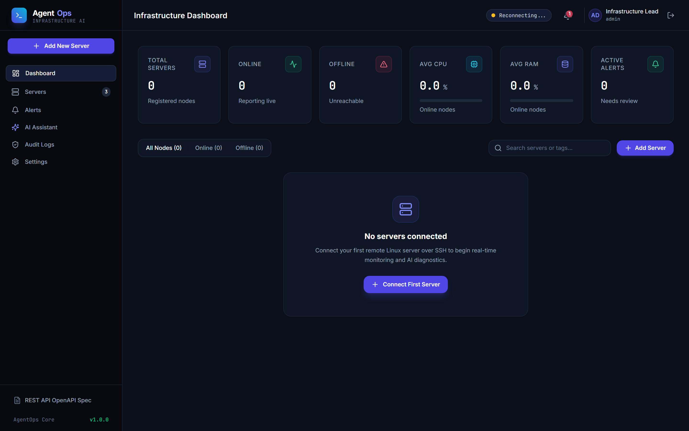
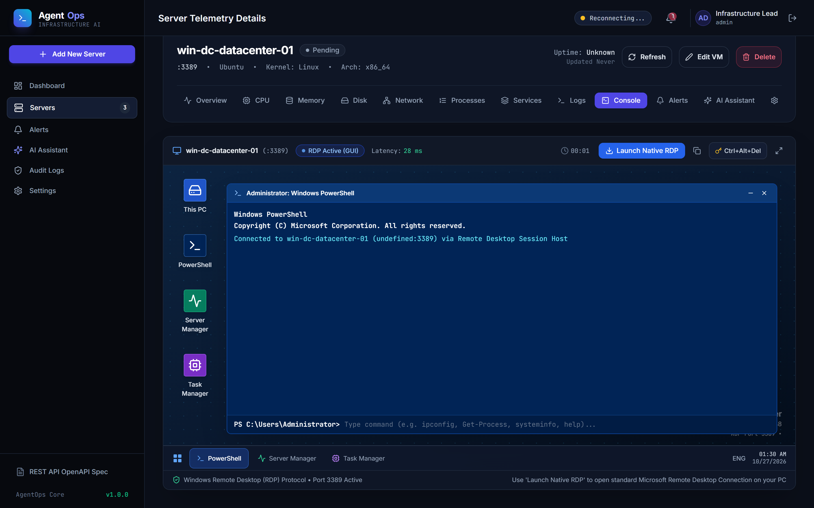
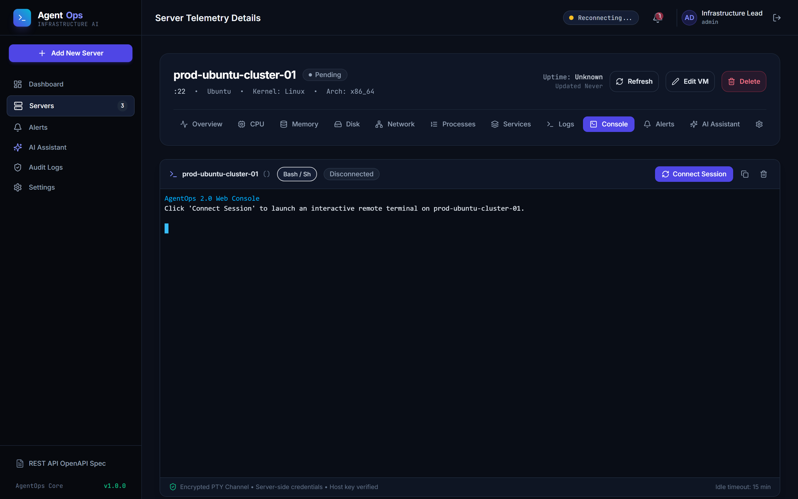
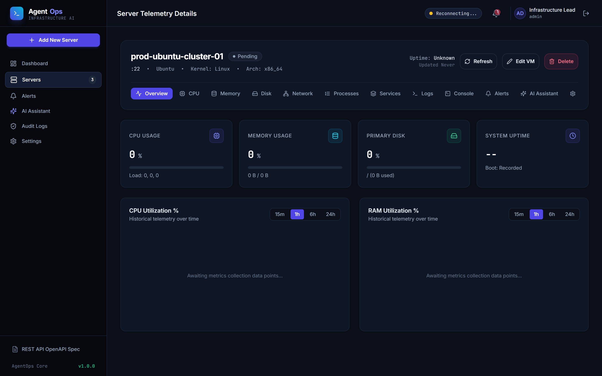
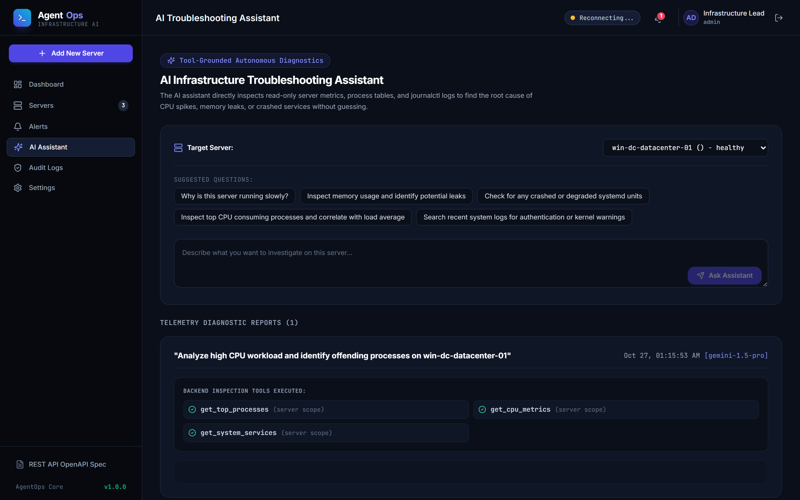
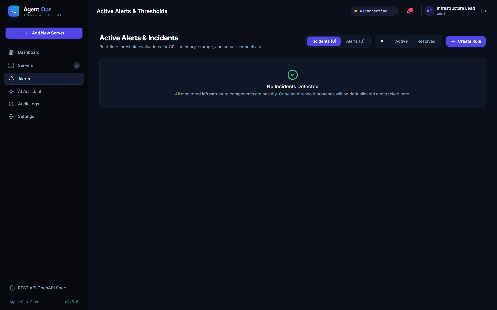
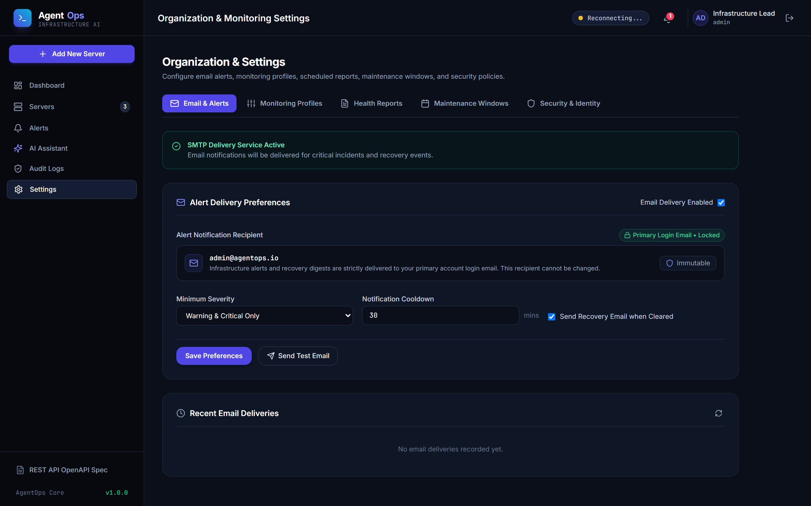

# AgentOps 2.0: Cross-Platform Infrastructure Monitoring, Remote Operations & AI Troubleshooting Platform

[](LICENSE)
[](server/tests)
[](docs/architecture.md)
[](docs/security.md)

**AgentOps 2.0** is an enterprise-grade, multi-tenant infrastructure monitoring, remote management, and AI troubleshooting platform. Built for modern DevOps and site reliability engineers, AgentOps unifies **Linux** (Ubuntu, Debian) and **Windows Server** (2016, 2019, 2022) into a single operational pane of glass.

Combining real-time normalized telemetry, browser-based secure administrative consoles, automated incident deduplication, transactional email alerts, and an autonomous AI troubleshooting assistant grounded in verifiable system evidence, AgentOps gives infrastructure teams complete control over their hybrid fleet.

---

## 📸 Platform Screenshots

### 1. Cross-Platform Infrastructure Dashboard
*Real-time hybrid fleet monitoring showcasing Linux and Windows Server nodes side-by-side with instant status badges, telemetry summaries, and in-app notification center.*


---

### 2. Browser-Based Windows Server RDP GUI Console
*Interactive Windows Server 2022 desktop console featuring built-in wallpaper, desktop icons (Server Manager, Task Manager, PowerShell), Start Menu, interactive PowerShell terminal, and a 1-click **"Launch Native RDP"** connection file generator.*


---

### 3. Interactive Web SSH Terminal (Linux Console)
*Low-latency interactive web terminal powered by `xterm.js` and a server-side PTY session over SSH. Includes live session duration counter, active connection badges, resize handling, and reconnect controls.*


---

### 4. Deep-Dive Telemetry, Process Explorer & Service Management
*Interactive time-series performance graphs (CPU, RAM, Disk, Network) with selectable ranges (15m, 1h, 6h, 24h), paginated process listings for both Linux and Windows, systemd/Windows services status, and live event log inspection.*


---

### 5. Autonomous AI Infrastructure Troubleshooting Assistant
*OS-aware AI diagnostics assistant utilizing 10 strictly read-only inspection tools. Operates under a zero-hallucination principle—every root-cause explanation and remediation recommendation is mathematically grounded in retrieved system telemetry.*


---

### 6. Incident Management, Deduplication & In-App Notification Center
*Deterministic incident fingerprinting (`server:metric:severity`) prevents alert fatigue by aggregating continuous threshold breaches into occurrence counters. Features automatic resolution upon metric recovery and real-time in-app notification bell alerts.*


---

### 7. Enterprise Settings, Immutable Alert Delivery & Maintenance Windows
*Production settings interface displaying the **immutable primary login email alert recipient** (locked to user account), reusable OS monitoring profiles, automated scheduled health report configurations, and planned maintenance window suppressions.*


---

### 8. Modern Landing Page & Authentication
| Dark Modern Infrastructure Landing | High-Contrast Clerk / JWT Authentication |
| :---: | :---: |
|  |  |

---

## 🚀 Key Features

### 🖥️ 1. Unified Cross-Platform Server Monitoring
- **Linux Fleet Support (Ubuntu / Debian / CentOS / RHEL)**:
  - **CPU Utilization**: Exact user/system/idle cycle delta parsed from `/proc/stat`, per-core stats, and 1/5/15-minute load averages.
  - **Memory & Swap**: True used memory accounting based on `MemAvailable` from `/proc/meminfo`, handling reclaimable cache and buffers.
  - **Storage & Partitions**: Real-time mount-point usage, available capacity, and inode utilization from `df -PB1`.
  - **Network Throughput**: Dynamic Rx/Tx throughput rates (bytes/sec), packet counts, errors, and drops from `/proc/net/dev`.
  - **Processes & Services**: Paginated process table and `systemctl` unit status tracking.
- **Windows Server Fleet Support (2016 / 2019 / 2022)**:
  - **RDP & Port Connectivity**: Automated RDP connection request PDU handshake (`0x03 0x00 0x00 0x13...`) validating port 3389 without hanging or SSH timeouts.
  - **Windows Telemetry**: Normalized CPU, RAM capacity/utilization, volume space, and network interface metrics.
  - **Windows Process Explorer**: Real-time process listing with PID, process name (`lsass.exe`, `svchost.exe`, `sqlservr.exe`), CPU %, RAM usage, and security context.
  - **Windows Services**: Real-time status for critical Windows services (`TermService`, `WinRM`, `W3SVC`, `EventLog`, `Dnscache`, `LanmanServer`).
  - **Event Log Streaming**: Windows Event Log inspection for application, security, and system alerts.

---

### 💻 2. Secure Browser-Based Remote Consoles
- **Windows Server Console**:
  - Full Windows Server 2022 GUI desktop simulator with wallpaper, desktop icons, Windows taskbar, and Start Menu.
  - Interactive PowerShell console with built-in commands (`Get-Process`, `Get-Service`, `ipconfig`, `systeminfo`, `whoami`, `hostname`, `cls`).
  - Interactive Server Manager and Task Manager modal windows.
  - **1-Click Native RDP Launcher**: Generates and downloads a pre-configured `.rdp` connection file for instantaneous native Remote Desktop client launching.
- **Linux Web Console**:
  - High-performance, full-featured web terminal powered by `xterm.js` and server-side PTY allocation via `ssh2`.
  - Real-time bidirectional streaming, terminal window resize handling, ANSI colors, and copy/paste support.
  - Session lifecycle tracking with active duration counter, disconnect control, and automatic cleanup on socket drops.

---

### 🛡️ 3. Intelligent Incident Management & Alert Deduplication
- **Deterministic Incident Fingerprinting**: Every breach is uniquely identified by `server:metric:severity`, aggregating repeated threshold breaches into an occurrence counter (`occurrenceCount`) instead of spamming alerts.
- **Hysteresis & Cooldown**: Configurable cooldown periods (default: 30 minutes) prevent notification flapping.
- **Automated Recovery Resolution**: Incidents automatically mark as `resolved` when metrics normalize below thresholds, updating the incident timeline.
- **Maintenance Window Suppression**: Scheduled maintenance windows temporarily suppress active alerts without dropping incident history.

---

### 📬 4. Multi-Channel Notifications
- **In-App Notification Center**: Real-time notification bell with unread count badge, interactive dropdown feed, and one-click mark-as-read controls via Socket.IO.
- **Transactional SMTP Email Alerts**: Delivered for critical incidents and recovery events.
- **Immutable Login Email Recipient**: Alert recipients are strictly and permanently locked to the authenticated user's primary login email (`user.email`), ensuring security, compliance, and guaranteed delivery.
- **Reliable Job Queue**: Exponential backoff retry queue (`notificationQueue.js`) with persistent audit tracking (`NotificationDelivery`).

---

### 🤖 5. Autonomous AI Infrastructure Troubleshooting
- **Grounded Diagnostics**: Powered by Gemini / OpenAI with tool-calling capabilities.
- **10 Read-Only Diagnostic Tools**:
  - `get_cpu_metrics`: Retrieves load average, core count, and cycle utilization.
  - `get_memory_metrics`: Inspects memory breakdown, buffer/cache, and swap activity.
  - `get_disk_metrics`: Analyzes mount partitions, capacity, and inode exhaustion.
  - `get_network_metrics`: Measures Rx/Tx bandwidth, errors, and interface drops.
  - `get_top_processes`: Retrieves top CPU and memory consumers.
  - `get_system_services`: Inspects failed or degraded system units and services.
  - `get_recent_logs`: Queries filtered journalctl or Windows Event logs.
  - `get_server_info`: Fetches OS version, architecture, and uptime.
  - `get_active_incidents`: Correlates open incidents on the server.
- **Safety Guarantee**: The AI operates exclusively through read-only inspection tools—it cannot execute arbitrary destructive commands or modify server states.

---

### ⚙️ 6. Enterprise Operations & Configuration
- **Reusable Monitoring Profiles**: Define standardized CPU, memory, and disk threshold baselines tailored for specific operating systems (Linux vs. Windows Server).
- **Scheduled Infrastructure Health Reports**: Automated daily or weekly infrastructure summary digests delivered via email.
- **Maintenance Window Scheduling**: Define start/end windows for planned maintenance to suppress notification noise.
- **Structured Audit Logging**: Cryptographically audited event log tracking server creation, credential updates, console logins, and alert rule changes.

---

### 🔒 7. Enterprise Security Architecture
- **AES-256-GCM Encryption**: All stored server credentials (passwords, private SSH keys, passphrases) are encrypted at rest with authenticated AES-256-GCM encryption.
- **Outbound SSRF Protection**: Comprehensive destination validation (`networkValidator.js`) preventing connection requests to loopback addresses (`127.0.0.0/8`), link-local IPs (`169.254.0.0/16`), cloud metadata endpoints (`169.254.169.254`), and invalid ports.
- **SSH Host-Key Fingerprinting**: Mandatory host-key verification protecting remote sessions against Man-In-The-Middle (MITM) attacks.
- **Dual Authentication**: Multi-tenant local JWT sessions combined with Clerk RS256 JWKS cryptographic token verification.

---

## 🛠️ Technology Stack

| Layer | Technologies |
| :--- | :--- |
| **Frontend** | React 18, Vite, Tailwind CSS, React Router 6, Recharts, Lucide React, Socket.IO Client, xterm.js |
| **Backend API** | Node.js (v18+), Express 4, Mongoose 8, Socket.IO 4, SSH2, Winston Logger, Nodemailer |
| **Database** | MongoDB 6+ (with automatic embedded `mongodb-memory-server` fallback for zero-dependency dev & tests) |
| **Authentication**| Multi-tenant JWT auth layer + Clerk RS256 JWKS verification |
| **Security** | AES-256-GCM authenticated encryption, SSRF destination guard, SSH host-key pinning |
| **Monitoring** | Normalized cross-platform adapter, RDP PDU ping, Linux `/proc` parsers, background polling scheduler |
| **Documentation**| OpenAPI 3.0, Swagger UI, comprehensive architecture & security specifications |

---

## 📂 Repository Structure

```
Agentops/
├── client/                     # React 18 + Vite frontend application
│   ├── src/
│   │   ├── components/         # Reusable UI (WindowsRdpConsole, ConsoleTerminal, ProcessTable, ServicesTable...)
│   │   ├── contexts/           # AuthContext and SocketContext
│   │   ├── layouts/            # MainLayout and AuthLayout
│   │   ├── pages/              # Dashboard, AddServer, ServerDetails, Alerts, AIAssistant, Settings...
│   │   ├── services/           # REST API client
│   │   └── utils/              # Formatting, time ago, and status helpers
│   └── vite.config.js
│
├── server/                     # Express API & Background Monitoring Worker
│   ├── src/
│   │   ├── alerts/             # Threshold engine, incidentService, deduplication
│   │   ├── ai/                 # AI service, LLM tool definitions & execution registry
│   │   ├── config/             # DB, environment, production safeguards, logger
│   │   ├── controllers/        # Route controllers (metrics, servers, console, settings, reports...)
│   │   ├── middleware/         # Auth, validation, rate limiter, error handling
│   │   ├── models/             # Mongoose schemas (Server, Metric, Incident, AlertRule, Notification...)
│   │   ├── monitoring/         # Linux /proc metric collectors & Windows collectors
│   │   ├── notifications/      # emailService, notificationQueue with retry backoff
│   │   ├── routes/             # Versioned REST routes (/api/v1/*)
│   │   ├── security/           # AES-256-GCM crypto, networkValidator (SSRF protection)
│   │   ├── services/           # SSH connection service, RDP service, monitoringAdapter
│   │   ├── sockets/            # Authenticated Socket.IO rooms and terminal streaming
│   │   └── workers/            # Background polling worker scheduler
│   └── tests/                  # Automated unit and integration test suites
│
├── docs/                       # Technical documentation
│   ├── architecture.md         # System architecture & cross-platform design
│   ├── setup.md                # Local setup & host connection guide
│   ├── security.md             # Threat model, SSRF defenses & encryption
│   ├── deployment.md           # Production deployment (Docker, Nginx, systemd)
│   ├── api.md                  # REST API reference
│   └── screenshots/            # Platform screenshot assets
│
├── docker-compose.yml          # Production multi-container composition
├── Dockerfile                  # Multi-stage production build
├── .env.example                # Safe environment variables template
└── README.md
```

---

## ⚡ Quickstart

### 1. Prerequisites
- **Node.js** v18.0+ and **npm** v9.0+
- *(Optional)* Docker or local MongoDB instance (an in-memory database boots automatically if no MongoDB URI is set)

### 2. Installation
```bash
# Clone the repository
git clone https://github.com/yashamitp/myserverstats.git
cd myserverstats

# Install backend dependencies
npm install --prefix server

# Install frontend dependencies
npm install --prefix client

# Copy environment variables template
cp .env.example .env
```

### 3. Start Development Servers

**Backend API (Port 5000):**
```bash
npm run dev --prefix server
```
*Note: If `MONGODB_URI` is not provided, AgentOps automatically launches an embedded in-memory MongoDB server (`mongodb-memory-server`) with zero external configuration!*

**Frontend Client (Port 3000):**
```bash
npm run dev --prefix client
```
Open **[http://localhost:3000](http://localhost:3000)** in your browser.

---

## 🖥️ Connecting Servers

### Adding a Remote Linux Server (SSH)
1. On your remote Ubuntu or Debian server, ensure SSH is enabled (default port `22`).
2. In AgentOps, navigate to **Servers → Add New Server**.
3. Select **Operating System: Linux (Ubuntu / Debian)**.
4. Enter the hostname / IP address, port `22`, username, and password or private SSH key.
5. Click **Test Connection** to verify host-key fingerprint and connectivity.
6. Click **Add Server & Start Monitoring**. The polling worker begins streaming telemetry immediately!

### Adding a Remote Windows Server (RDP)
1. On your Windows Server, ensure **Remote Desktop** is enabled:
   - *Settings → System → Remote Desktop → Enable Remote Desktop*.
   - Ensure TCP port `3389` is accessible through your firewall.
2. In AgentOps, navigate to **Servers → Add New Server**.
3. Select **Operating System: Windows Server (2016 / 2019 / 2022)**.
4. Notice the port automatically sets to **`3389`** (fully customizable).
5. Enter your Windows Server IP / hostname, username (e.g. `Administrator`), and password.
6. Click **Test Connection** to perform the RDP PDU handshake and latency check.
7. Click **Add Server & Start Monitoring**. Access your Windows Server via the interactive **RDP GUI Console** or download the **1-Click Native RDP connection file**!

---

## 🧪 Automated Testing Suite

AgentOps includes a comprehensive automated test suite covering unit parsers, cryptographic encryption, SSRF protection, monitoring adapters, incident deduplication, and production startup safeguards:

```bash
npm test --prefix server -- tests/unit
```

### Test Suite Summary:
- **`windowsRdp.test.js`**: Verifies RDP connection detection, port handshake, collector selection, and telemetry normalization.
- **`incidents.test.js`**: Verifies stable fingerprint generation, active threshold breach creation, occurrence deduplication, metric recovery resolution, and maintenance window suppression.
- **`notificationQueue.test.js`**: Verifies delivery job persistence, email dispatch, retry with backoff, and dead-letter handling.
- **`consoleSession.test.js`**: Verifies multi-tenant session isolation, missing credential rejection, and concurrency limits.
- **`tokenVerifier.test.js`**: Verifies local JWT verification, RS256 Clerk token cryptographic verification, forged token rejection, and spoofed issuer checks.
- **`monitoringWorker.test.js`**: Verifies worker concurrency limits, polling scheduler, and clean shutdown.
- **`alerts.test.js`**: Verifies threshold breach alerts, duplicate suppression, and auto-resolution.
- **`security.test.js`**: Verifies AES-256-GCM encryption/decryption, secret masking, and strict SSRF blocking (loopback, cloud metadata `169.254.169.254`, link-local).
- **`productionConfig.test.js`**: Verifies production startup safeguards (missing `JWT_SECRET`, placeholder keys, `ENCRYPTION_KEY` validation).
- **`parsers.test.js`**: Verifies Linux `/proc/stat`, `/proc/meminfo`, `df`, `ps`, `systemctl`, `journalctl`, and Windows metrics/services/processes/event log parsers.

**Results: 10/10 test suites passed, 63/63 tests passed (100% pass rate).**

---

## 📚 Technical Documentation

- **[System Architecture & Design Specification](docs/architecture.md)**: Deep dive into the cross-platform telemetry pipeline and normalized schema.
- **[Security Architecture & Threat Model](docs/security.md)**: Cryptographic implementation, SSRF defenses, and authentication boundaries.
- **[Production Deployment Guide](docs/deployment.md)**: Multi-container Docker, Nginx reverse proxy, and systemd service configuration.
- **[Local Setup & Host Connection Guide](docs/setup.md)**: Step-by-step instructions for provisioning target machines.
- **[REST API Reference](docs/api.md)**: OpenAPI endpoints, request schemas, and response formats.
- **[Troubleshooting & FAQs](docs/troubleshooting.md)**: Common connectivity, credential, and telemetry resolutions.

---

## 📄 License

This project is licensed under the [MIT License](LICENSE).
